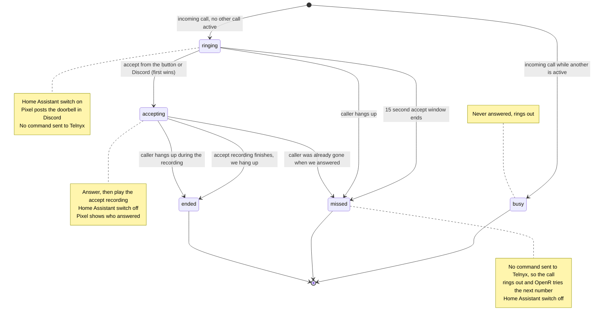

# pixel-phone

Answers the Pixelbar doorbell.

When someone presses the doorbell at the building, OpenR's intercom calls a list of numbers in turn. One of them is a Telnyx number that rings pixel-phone. pixel-phone then:

1. flips a Home Assistant switch, which rings the siren in the space, and
2. tells Pixel, which posts the doorbell in Discord with an **Answer** button.

When someone presses the button in the space, or **Answer** in Discord, pixel-phone picks up and plays a recording ("someone is on their way to let you in"), then hangs up. The first accept wins, wherever it comes from.

pixel-phone **answers only when someone accepts.** OpenR moves to the next number on its list only when a call goes unanswered. If we answered and then hung up, OpenR would treat the doorbell as handled. So until someone accepts, pixel-phone sends Telnyx no command at all. If nobody accepts in time, or anything breaks, the call rings out and OpenR tries the next number.

## Try it first

With Node 24, pnpm, [just](https://just.systems) and Docker:

```sh
just install
just azurite                          # local Azure Storage in Docker
just simulate-call --accept-after 3   # a whole doorbell call, accepted after 3 s
```

`just simulate-call` starts the real app against Azurite, a fake Telnyx and a fake Home Assistant, rings it with signed webhooks, accepts through the accept API, and prints a timeline:

```text
+  1.11s  telnyx → webhook call.initiated (v3:harness-e2f9d3fb) → 200
+  1.13s  home assistant ← turn_on input_boolean.pixel_phone_ringing_dev
+  1.14s  app: call.ringing callId=20261117-a78098360611
+  1.31s  queue → pixel: ringing
+  4.16s  home-assistant → POST /api/v1/calls/current/accept → 202 {"callId":"20261117-a78098360611"}
+  4.16s  telnyx ← command answer (v3:harness-e2f9d3fb)
+  4.16s  home assistant ← turn_off input_boolean.pixel_phone_ringing_dev
+  4.17s  telnyx ← command playback_start (v3:harness-e2f9d3fb)
+  4.22s  queue → pixel: accepted via=home-assistant
+  6.21s  telnyx → webhook call.playback.ended (v3:harness-e2f9d3fb) → 200
+  6.24s  telnyx ← command hangup (v3:harness-e2f9d3fb)
+  6.26s  app: call.ended callId=20261117-a78098360611 reason=playback_finished via=home-assistant
+  6.33s  queue → pixel: ended reason=playback_finished
```

Try `--accept-via pixel`, `--hangup-after 2`, `--second-call`, `--ha-down`, `--queue-down`, or no accept at all (`--window 5` makes the timeout quick). `just simulate-call --help` lists them. Then `just check` runs lint, types and tests, and [AGENTS.md](AGENTS.md) has the conventions.

## Call states



Leaving `ringing` always turns the Home Assistant switch off. Home Assistant may already have switched it off itself, which does no harm.

## Status

The call flow works end to end on dev: Telnyx webhooks, the state machine, Home Assistant, the queue for Pixel, the accept API and the recording. Still to come: Pixel's side (#19), Home Assistant's automations (#18) and prod (#20, #21). See the [runbook](docs/runbook.md) to run or test it.
