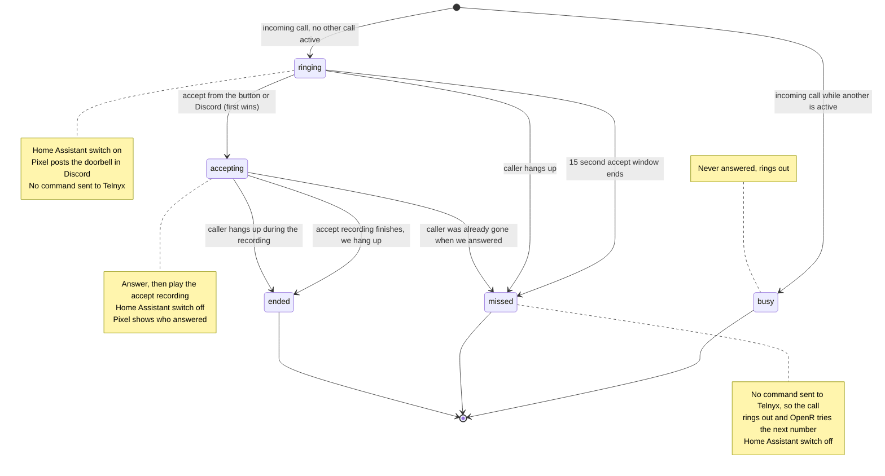

# pixel-phone

Answers the Pixelbar doorbell.

When someone presses the doorbell at the building, OpenR's intercom calls a list of numbers in turn. One of them is a Telnyx number that rings pixel-phone. pixel-phone then:

1. flips a Home Assistant switch, which rings the siren in the space, and
2. tells Pixel, which posts the doorbell in Discord with an **Answer** button.

When someone presses the button in the space, or **Answer** in Discord, pixel-phone picks up and plays a recording ("someone is on their way to let you in"), then hangs up. The first accept wins, wherever it comes from.

pixel-phone **answers only when someone accepts.** OpenR moves to the next number on its list only when a call goes unanswered. If we answered and then hung up, OpenR would treat the doorbell as handled. So until someone accepts, pixel-phone sends Telnyx no command at all. If nobody accepts in time, or anything breaks, the call rings out and OpenR tries the next number.

## Call states

Leaving `ringing` always turns the Home Assistant switch off. Home Assistant may already have switched it off itself, which does no harm.

## Status

Nothing is built yet. The work is planned as [issues](https://github.com/pixelbar/pixel-phone/issues), from the bottom up: scaffold and infrastructure first, then Telnyx, then the call flow, then prod.
