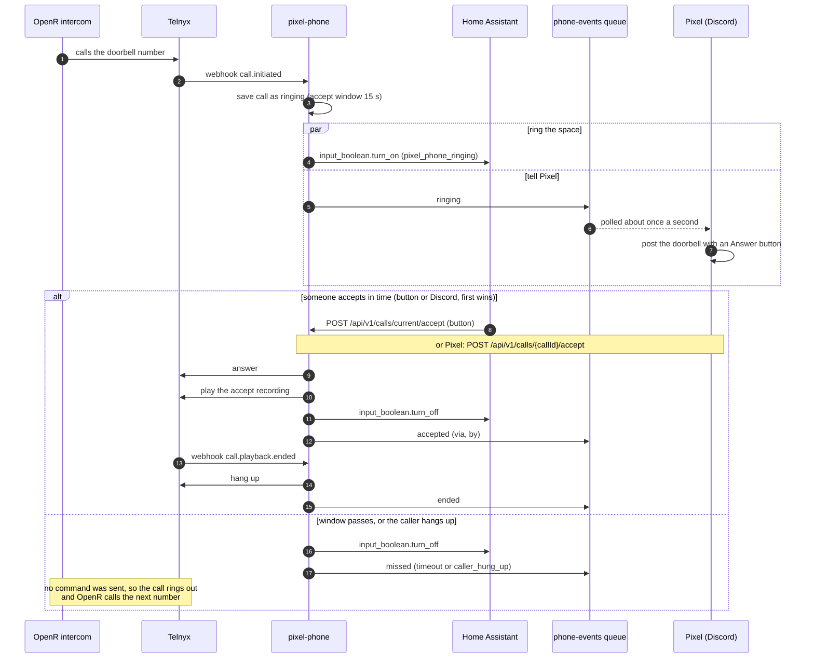

# Architecture

pixel-phone answers the Pixelbar doorbell. See the [README](../README.md) for the call state diagram.

## Parts

| Part           | Role                                                                                                                           |
| -------------- | ------------------------------------------------------------------------------------------------------------------------------ |
| OpenR intercom | Calls a list of numbers when the doorbell is pressed, and moves on only when a call goes unanswered                            |
| Telnyx         | Owns the number and sends call events to pixel-phone's webhook (Call Control)                                                  |
| pixel-phone    | Tracks the call, flips the Home Assistant switch, tells Pixel, and answers when someone accepts                                |
| Home Assistant | Owns the siren and the button. Turns the siren on and off from the switch, and calls the accept API when the button is pressed |
| Pixel          | Reads call events from a queue, posts the doorbell in Discord with an Answer button, and calls the accept API                  |

## Call flow

pixel-phone sends Telnyx no command until someone accepts ([ADR 0002](adr/0002-answer-only-on-accept.md)). If nobody accepts, the call rings out and OpenR tries the next number.

## Decisions

| ADR | Decision |
| --- | --- |
| [0001](adr/0001-typescript-ports-and-adapters.md) | TypeScript, ports and adapters, fastify |
| [0002](adr/0002-answer-only-on-accept.md) | Telnyx Call Control, and we answer only on accept |
| [0003](adr/0003-container-apps.md) | Azure Container Apps, scale to zero, public ingress, two environments |
| [0004](adr/0004-call-state-in-table-storage.md) | Call state in Table storage, one call at a time, first accept wins |
| [0005](adr/0005-home-assistant-owns-the-siren.md) | Home Assistant owns the siren |
| [0006](adr/0006-pixel-through-a-storage-queue.md) | Pixel through an Azure Storage Queue |
| [0007](adr/0007-telnyx-config-by-script.md) | Telnyx config by a script, not Terraform |
| [0008](adr/0008-recordings-in-blob-storage.md) | Recordings in our own Blob container |
| [0009](adr/0009-sentry-pino-and-phone-numbers.md) | Sentry and pino; phone numbers aren't treated as private |
| [0010](adr/0010-terraform-bootstrap-and-oidc.md) | Terraform bootstrap and GitHub OIDC |

## Configuration

Every setting is read in `src/config.ts`. This table grows as features land.

| Variable | Required | Description |
| -------- | -------- | ----------- |
