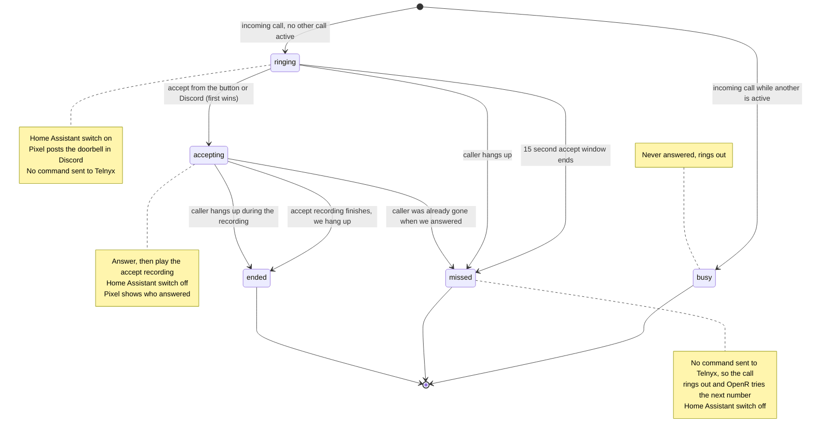

# pixel-phone

Answers the Pixelbar doorbell.

When someone presses the doorbell at the building, OpenR's intercom calls a list of numbers in turn. One of them is a Telnyx number that rings pixel-phone. pixel-phone then:

1. flips a Home Assistant switch, which rings the siren in the space, and
2. tells Pixel, which posts the doorbell in Discord with an **Answer** button.

When someone presses the button in the space, or **Answer** in Discord, pixel-phone picks up and plays a recording ("someone is on their way to let you in"), then hangs up. The first accept wins, wherever it comes from.

::: warning pixel-phone answers only when someone accepts
OpenR moves to the next number on its list only when a call goes unanswered. If we answered and then hung up, OpenR would treat the doorbell as handled. So until someone accepts, pixel-phone sends Telnyx no command at all. If nobody accepts in time, or anything breaks, the call rings out and OpenR tries the next number ([ADR 0002](adr/0002-answer-only-on-accept.md)).
:::

## Call flow

Every call goes through these states. [Architecture](architecture.md#call-flow) shows the same flow as messages between OpenR, Telnyx, pixel-phone, Home Assistant and Pixel.



Leaving `ringing` always turns the Home Assistant switch off. Home Assistant may already have switched it off itself, which does no harm.

## Where to go next

| Page | What it covers |
| --- | --- |
| [Architecture](architecture.md) | The parts, the call flow message by message, the decisions and every setting |
| [Infrastructure](infra.md) | Azure, Terraform, and which identity can reach what |
| [Accept API](accept-api.md) | How Home Assistant and Pixel accept a call |
| [Call events for Pixel](events.md) | The `phone-events` queue contract |
| [Home Assistant](home-assistant.md) | Connecting an environment, the accept button and the token |
| [Runbook](runbook.md) | Deploying, secrets, Telnyx, testing a real call, and what to do when the doorbell doesn't ring |
| Decisions | The ADRs, in the sidebar. Don't reopen one because an old issue says otherwise: write a new ADR that supersedes it |

To try it on a laptop with Node 24, pnpm, [just](https://just.systems) and Docker:

```sh
just install
just azurite                          # local Azure Storage in Docker
just simulate-call --accept-after 3   # a whole doorbell call, accepted after 3 s
```

The [repository](https://github.com/pixelbar/pixel-phone) has the code, and its `AGENTS.md` the conventions.
