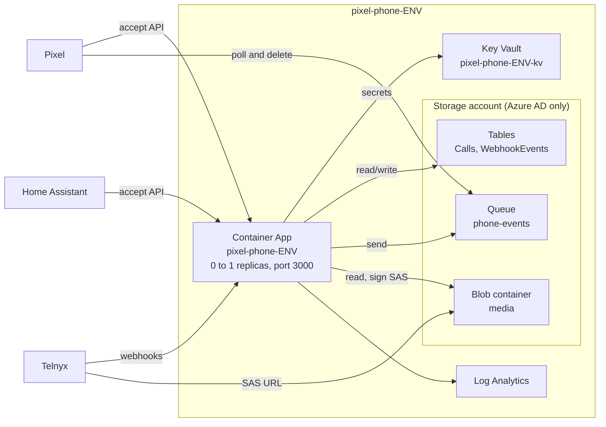

# Infrastructure

pixel-phone runs on Azure Container Apps in the Pixelbar subscription (`d150e252-e2f0-47fb-8a4a-c3f29e9aebd4`), West Europe. Terraform lives in `infra/`:

| Stack | Applied by | What it holds |
| --- | --- | --- |
| [`infra/bootstrap`](../infra/bootstrap) | an Owner, by hand, once | resource groups, state containers, GitHub OIDC identities ([ADR 0010](adr/0010-terraform-bootstrap-and-oidc.md)) |
| [`infra/envs/dev`](../infra/envs/dev) | a maintainer, `just tf-apply dev` | one environment of [`modules/pixel-phone`](../infra/modules/pixel-phone) |
| `infra/envs/prod` | a maintainer, `PIXEL_PHONE_APPLY_PROD=1 just tf-apply prod` | the same module (#20) |

CI validates every stack and plans dev on pull requests that touch `infra/` (`terraform.yml`). Nothing applies from CI.

## One environment

## Who can reach what

The storage account has **shared keys off**, so every data access needs an Azure AD role. Contributor on the resource group (which the GitHub identity has) can't read any data.

| Identity | Role | Scope |
| --- | --- | --- |
| App (`pixel-phone-ENV-app`) | Key Vault Secrets User | the environment's vault |
| App | Storage Table Data Contributor | tables `Calls` and `WebhookEvents` |
| App | Storage Queue Data Message Sender | queue `phone-events` |
| App | Storage Blob Data Reader | container `media` (it can't change recordings) |
| App | Storage Blob Delegator | the account (to sign user-delegation SAS URLs) |
| Pixel (`pixel-ENV-app`) | Storage Queue Data Message Processor | queue `phone-events` only |
| The maintainer who applies | Key Vault Administrator | the vault (`just secrets-push`) |
| The maintainer who applies | Storage Blob Data Contributor | container `media` (`just media push`) |
| GitHub `pixel-phone-github-ENV` | Contributor | resource group `pixel-phone-ENV` |
| GitHub `pixel-phone-github-ENV` | Storage Blob Data Contributor | state container `pixel-phone-ENV` |

## Images

The Container App is created from `container_image`, then Terraform ignores the image. Deploys swap it with `az containerapp update` ([ADR 0003](adr/0003-container-apps.md)). dev was created with a placeholder (`traefik/whoami`, told to listen on port 3000) and has run pixel-phone since the first deploy (#6).
